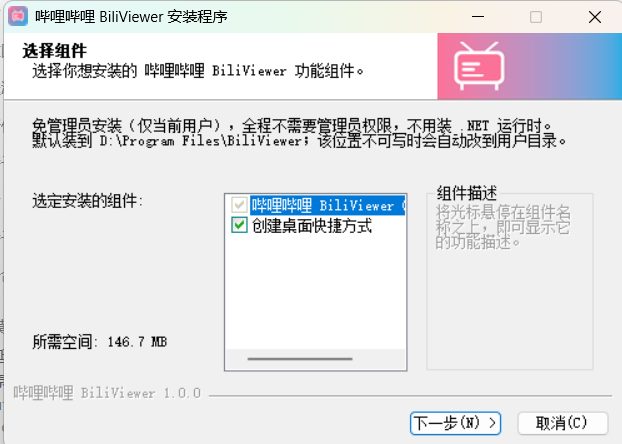
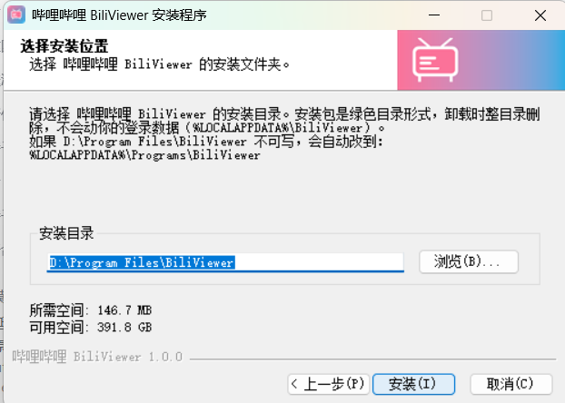
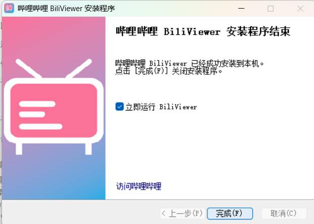

# BiliViewer for Windows

哔哩哔哩桌面客户端（Windows 版），由 macOS 版 [BiliViewer](https://github.com/seanjin0513/BiliViewer) 移植而来。

## 下载

前往 [Releases](https://github.com/seanjin0513/BiliViewerWin/releases/latest) 下载
`BiliViewer-Setup-1.0.0.exe`，双击即可安装。安装包包含 .NET 运行时，无需管理员权限。

技术栈：**C# + WPF（.NET 8）+ WebView2**。外壳是一个原生 Windows 窗口，里面用 WebView2 承载 B 站网页；
播放器增强交互（滚轮调音量、单击暂停、双击全屏、侧键前进后退）由注入到页面里的 JS 完成，
窗口全屏、系统音量、菜单、窗口位置记忆等交给原生代码。


## 直接运行

```
dist\BiliViewer\BiliViewer.exe
```

`dist\BiliViewer` 是**自包含**的绿色目录（约 147 MB / 252 个文件，自带 .NET 运行时），复制到任意位置双击即可，
不需要安装 .NET，也不需要安装本程序。

系统要求：

- Windows 10 1809+ / Windows 11，x64
- WebView2 Evergreen Runtime —— Windows 11 自带；Windows 10 需要装一次
  <https://developer.microsoft.com/microsoft-edge/webview2/>（大多数装着 Edge 的机器已有）

## 安装（可选）

不想手动复制绿色目录的话，可以用安装包：

```
dist\BiliViewer-Setup-1.0.0.exe
```

- 默认安装位置 **`D:\Program Files\BiliViewer`**；如果该位置不可写（盘不存在 / 没有写权限），
  会自动改到 `%LOCALAPPDATA%\Programs\BiliViewer`。安装目录页可以自己改。
- **不需要管理员权限**：默认是「仅当前用户」安装（注册表写 `HKCU`，快捷方式只给当前用户），
  全程不会弹 UAC。
- 可选是否创建桌面快捷方式；完成后可以勾选「立即运行 BiliViewer」。
- 卸载：Windows「设置 → 应用 → 已安装的应用 → 哔哩哔哩 BiliViewer」，或开始菜单里的
  「卸载 BiliViewer」。卸载只删程序目录与快捷方式，**保留** `%LOCALAPPDATA%\BiliViewer`
  里的登录数据、窗口位置和灵敏度设置。
- 静默安装 / 卸载（脚本用）：`BiliViewer-Setup-1.0.0.exe /S`、`Uninstall.exe /S`；
  自定义目录：`BiliViewer-Setup-1.0.0.exe /S /D=D:\Apps\BiliViewer`（`/D=` 必须是最后一个参数、路径不加引号）。
- 安装包**没有代码签名**，首次运行 Windows 可能弹 SmartScreen「Windows 已保护你的电脑」，
  点「更多信息 → 仍要运行」即可。
- 想装成「所有用户」的版本（需要管理员）：
  `.\build.ps1 -Installer -PerMachineInstaller` —— 注册表改 `HKLM`、默认目录 `%ProgramFiles%\BiliViewer`、
  快捷方式给所有用户。

安装向导是「组件页 → 目录页 → 安装 → 完成页」（没有欢迎页），目录页默认就是 `D:\Program Files\BiliViewer`：







## 功能

| 操作 | 效果 |
| --- | --- |
| 鼠标停在播放器上滚轮 | 调**视频音量**（每格 2%），播放器中央显示白色喇叭 + 百分比 HUD，页面不滚动 |
| ⌥/Alt + 滚轮 | 调**系统音量**（同样的 HUD 位置） |
| 播放器上单击 | 暂停 / 播放（延迟 260ms 等双击，避免双触发） |
| 播放器上双击 | 网页全屏 + 窗口全屏；再次双击恢复 |
| ESC | 退出全屏（网页全屏与窗口全屏一起退） |
| 鼠标侧键 后退 / 前进 | 页面后退 / 前进（由 Chromium 原生处理，只走一格） |
| F11 | 窗口全屏 / 还原 |
| 拖窗口 / 关闭 | 位置、大小、最大化状态自动记住 |

菜单：`视图` 里有滚轮灵敏度（慢 60% / 标准 / 快 150%，持久化）、强制刷新、开发者工具；
`文件` 有主页 / 后退 / 前进 / 刷新。

滚轮调音量时播放器中央的 HUD：


### 快捷键

| 快捷键 | 效果 |
| --- | --- |
| F11 | 窗口全屏 / 还原 |
| F5 / Ctrl+R | 刷新 |
| Ctrl+Shift+R / Shift+F5 | 强制刷新（忽略缓存，走 DevTools Protocol） |
| F12 | 打开开发者工具 |
| Ctrl+0 | 页面实际大小（重置缩放） |
| Alt+← / Alt+→ | 后退 / 前进 |
| Alt+Home | 回到 B 站主页 |

## 构建

需要 .NET 8 SDK 和 PowerShell 7（只需构建机装，运行机不用；Windows PowerShell 5.1 可能无法正确读取脚本的 UTF-8 中文）：

```powershell
pwsh -File .\build.ps1
```

脚本流程：定位 dotnet → 用 `tools\MakeIcon` 重新生成 `Assets\AppIcon.ico` → `dotnet publish -c Release -r win-x64 --self-contained true -o dist\BiliViewer` → 删 pdb → 打印产物统计。

参数：

- `-SkipIcon`：不重新生成图标（图标缺失时仍会报错）
- `-NoPublish`：只生成图标，不发布
- `-FrameworkDependent`：发布成依赖机器的框架版（体积小很多，但目标机器必须装 .NET 8 Desktop Runtime）
- `-Installer`：发布完成后再用 NSIS 打出 `dist\BiliViewer-Setup-1.0.0.exe`（约 45 MB，压缩到 31%）
- `-PerMachineInstaller`：和 `-Installer` 一起用，打「所有用户 + 需要管理员」的安装包

打安装包需要 NSIS 3.x 的 `makensis.exe`：脚本先找 `PATH`，找不到就用 `%TEMP%\nsis\nsis-3.11\Bin\makensis.exe`
（没装的话从 <https://github.com/tauri-apps/binary-releases/releases/download/nsis-3.11/nsis-3.11.zip> 解压一份）。
只改 `.nsi`、不想重新 publish 时用：

```powershell
.\build.ps1 -SkipIcon -NoPublish -Installer   # 约 100 秒
```

细节见 [installer/README.md](installer/README.md)。

只想编译调试版：

```powershell
dotnet build .\BiliViewerWin.csproj -c Debug
```

滚轮回归检查（需要 Node.js 22+ 和本机 Edge，无第三方依赖）：

```powershell
node tools/test-wheel.cjs
```

测试用隔离的临时浏览器配置验证真实滚轮输入，逐帧检查页面与嵌套容器不移动，
并检查音量、Alt/Ctrl、移出播放器后的页面滚动及原有内联样式恢复。

> 本机的 .NET SDK 装在用户目录（`%LOCALAPPDATA%\Microsoft\dotnet`）时，直接双击 `bin\Debug\...\BiliViewer.exe`
> 会弹「You must install .NET」，需要先设 `DOTNET_ROOT`。`dist` 里的自包含版本没有这个问题。

## 目录结构

```
BiliViewerWin.csproj    项目文件（net8.0-windows / WPF / 嵌入 page.js / 图标）
app.manifest            PerMonitorV2 高 DPI + longPathAware
App.xaml / App.xaml.cs  应用入口 + 全局异常兜底（写 %LOCALAPPDATA%\BiliViewer\error.log）
MainWindow.xaml(.cs)    窗口、菜单、WebView2 初始化、全屏、快捷键、消息路由
Web/page.js             注入到页面的交互脚本（滚轮/单击/双击/HUD/全屏/侧键）
SystemVolume.cs         系统音量（CoreAudio IAudioEndpointVolume，零第三方依赖）
Settings.cs             窗口位置、灵敏度（%LOCALAPPDATA%\BiliViewer\settings.json）
build.ps1               一键构建（可选打 NSIS 安装包）
installer/              NSIS 安装脚本 BiliViewer.nsi + 说明
tools/MakeIcon/         图标生成器（手写 ICO + PNG 帧，幂等）
Assets/AppIcon.ico      构建产物，同时嵌入 exe 与拷进 dist
```

运行数据都在 `%LOCALAPPDATA%\BiliViewer\`：`settings.json`（窗口状态 / 灵敏度）、`WebView2\`（登录 Cookie 等浏览器数据）、`error.log`（未处理异常时才有）。

## 实现要点（移植时踩过的坑）

- **滚轮事件在 WebView2 里 `cancelable` 恒为 false**。真实滚轮（`mouse_event`）到达页面时
  `event.cancelable === false`，`preventDefault()` 一律无效、页面照样被默认滚动；把监听挂在
  `document`（capture + `passive:false`）也只对合成事件有效。仅在 `scroll` 回调里拨回位置仍可能
  被合成器画出一帧，出现轻微抖动。因此 `page.js` 在指针进入播放器时就锁住页面和可滚动祖先
  的 `overflow`，保留滚动条占位，提前阻止默认滚动；`guardScroll()` 的位置恢复只作兜底。
  移出播放器或窗口失焦后立即恢复原有样式；位置守卫持续到最后一格滚轮后 320ms，
  在播放器外滚轮或按 Ctrl+滚轮也会立即释放，保留正常页面滚动和缩放。
- **页面把 `scroll-behavior` 设成了 `smooth`**，所以归位用的 `scrollTo()` 自己也变成平滑动画，
  抢不过滚轮那条平滑滚动（实测归位后页面还是滚了 200px）。`guardScroll()` 因此在守卫窗口内
  临时把 `html/body` 的 `scroll-behavior` 强制成 `auto`（`setProperty(..., 'important')`），
  收尾时再把内联样式还原，不影响 B 站自己的滚动动效。
- **B 站播放器自己也响应单击切暂停**（`onPerchClick` → `i.pause()`），偶尔会连着翻两次
  （`pause` 后又 `play`），导致「点一下没反应」。`page.js` 的单击不是发一次命令就完事：
  `finishClick()` 先按点击前的状态推出期望状态，再用 100ms 间隔的 `clickWatch` 巡查 1.2 秒，
  发现状态被页面翻走就纠正回来（最多 3 次）；任何新点击 / 双击都会先 `cancelClickWatch()`。
- **鼠标侧键不要再 post 给原生**。Chromium/WebView2 自己就会处理 XButton 前进后退，
  JS 里再发一次导航消息会退两格。`page.js` 里只处理左键，`nav` 消息留给原生做兜底。
- **裸 Alt 会激活 WPF 菜单模式**。菜单模态循环会把 WebView2 卡住几十秒，所以 `MainWindow.OnPreviewKeyDown`
  里把单独的 Alt 吃掉（`e.Handled = true`），Alt+滚轮 / Alt+←→ 不受影响。
- **B 站全屏走 HTML5 Fullscreen API**，ESC 被浏览器吃掉用于退出 HTML5 全屏，页面的 `keydown` 收不到，
  所以「网页退全屏 → 窗口跟着退全屏」在 `CoreWebView2.ContainsFullScreenElementChanged` 里兜底
  （`_fullscreenFollowsPage` 标记：只有双击带出来的窗口全屏才跟）。
- **窗口全屏**用「`WindowStyle=None` + 按 `GetMonitorInfo` 的显示器矩形铺满 + Topmost」实现，
  不是 `WindowState=Maximized`（后者会留任务栏）。
- **UA 必须注入** Chrome UA，否则 B 站判「浏览器版本过低」；UA 用 `CoreWebView2Settings.UserAgent`。
- **强制刷新**没有 API，走 DevTools Protocol：`CallDevToolsProtocolMethodAsync("Page.reload", "{\"ignoreCache\":true}")`。
- 顶栏/菜单栏在窗口全屏与页面 HTML5 全屏时自动隐藏。
- 页面上没有真实的窗口边框拖拽区，标题栏仍是系统的（`WindowChrome` 未改），保持简单可靠。

## 调试

程序支持一个调试钩子，把参数拼进 WebView2 的浏览器启动参数：

```powershell
$env:BILIVIEWER_BROWSER_ARGS='--remote-debugging-port=9222'
Start-Process .\dist\BiliViewer\BiliViewer.exe
```

然后用 CDP（`http://127.0.0.1:9222/json/list`）就能检查/驱动页面。
页面侧暴露了几个测试入口：`__bvStats`（wheel/click/dblclick/nav/sysvol 计数）、`__bvScreenState()`、
`__bvPaused()`、`__bvSetPaused(bool)`、`__bvSetSensitivity(倍率)`。

## 与 macOS 版的差异

- 音量 HUD 由原生 `NSWindow` 改成页面内 DOM 元素（避免 WPF 与 WebView2 的 airspace 遮挡问题，
  页面 HTML5 全屏时也能跟着挂载）。
- 系统音量从 CoreAudio（mac 的 AudioObject）换成 Windows CoreAudio 的
  `IAudioEndpointVolume::SetMasterVolumeLevelScalar`。
- 窗口全屏、强制刷新、前进后退改用 Windows / WebView2 的对应能力；顺手把 mac 版 `mediaDevices` 兜底删了
  （Chromium 自带 `navigator.mediaDevices`）。
- 滚轮手感换算变了：Windows 鼠标一格固定 `deltaY = 100`，所以按「格」给 2%（mac 版按像素给 0.12%）。
  灵敏度菜单仍是 60% / 100% / 150%。
